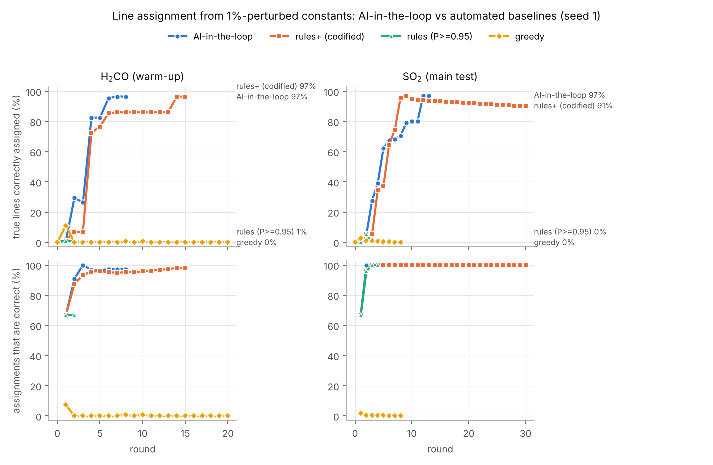
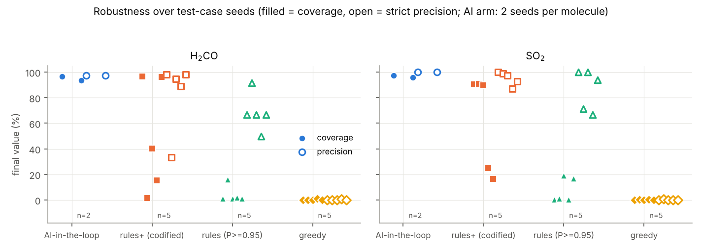
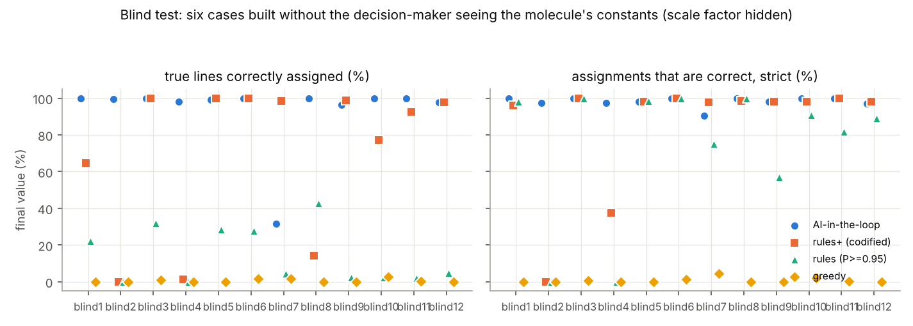

# AI-in-the-loop line assignment with SPFIT/SPCAT — a scorable proof of concept

**Nathan Ward**, UC Davis (chemistry + civil engineering) — prepared for Dr. Brian Drouin, JPL Molecular
Spectroscopy, as the first step of a SURF@JPL 2027 proposal. October 2026.
Code, data, decision logs: this repository (`README.md` explains how to rerun everything).

## 1. Summary

The bottleneck in rotational spectroscopy is **assignment**, not measurement. The question this
week's prototype asks: *does a judgement step in the SPFIT/SPCAT loop make automatic assignment work
where automation alone fails?* Test cases are built from real expert line lists (CDMS) for **SO₂**
(main test) and **H₂CO** (warm-up). In each, the labels are hidden, 15% of the lines are dropped, the
list is contaminated with **33–37% distractor peaks** (isotopologues, a vibrational satellite, random
peaks) and noise is added. The run starts from constants that are **0.5–1% off** in A, B, C and
**10–30% off** in the quartic constants, with every higher-order term missing.

| | greedy (no judgement) | rules (P ≥ 0.95) | rules+ (lessons codified) | **AI-in-the-loop** |
|---|---|---|---|---|
| SO₂, true lines correctly assigned | 0.0–0.2% (5 seeds) | 0.4–19% (5 seeds) | 17–91% (5 seeds) | **97.2% / 95.8%** (seeds 1, 4) |
| SO₂, assignments that are correct | 0–1% | 67–100% | 87–100% | **100% / 100%** |
| H₂CO, true lines correctly assigned | 0–1% | 1–16% (1–64%²) | 1.5–96.5% (0.5–95.5%²) | **96.5% / 93.4%** (seeds 1, 2) |
| H₂CO, assignments correct (strict / physics-aware¹) | 0–1% | 50–91% | 33–98% | **97.2–97.5% / 100%** |

² With the corrected finite-difference step (300 MHz); the as-run step was 3000 MHz, see §5.
SO₂ results are identical at both settings.

¹ All 11 "wrong" H₂CO labels are the second component of a high-Ka K-doublet that is degenerate to
<8 kHz (Doppler width 1.3–1.5 MHz) and that the CDMS list labels only once; see §4.3.

**Blind test (added after the first version).** Twelve new cases (two batches of six) were built by a script that draws the
molecule (6 SO₂, 6 H₂CO, shuffled within each batch), a hidden overall scale factor s ∈ [0.80, 1.25] applied to every
Hamiltonian parameter (so every frequency, and every constant, is unfamiliar), and a secret data seed,
from OS randomness, and writes them only to hidden files. The decision-maker never saw the official
or the true constants. All arms now run the same corrected code (300 MHz finite-difference step, the
fixes listed in §3.3).

| blind case (one seed each) | greedy | rules | rules+ | **AI-in-the-loop** |
|---|---|---|---|---|
| true lines correctly assigned, range over 12 cases | 0–2.9% | 0–43% | 0–100% (≥ 92% in 7 of 12) | **31–100%** (≥ 96.5% in 11 of 12) |
| pooled over the 12 cases | – | – | – | **95.7%** (3569/3729) |
| assignments that are correct (strict, pooled) | ~0% | – | – | **99.2%** (3611/3641) |

The AI arm clearly beat rules+ on 5 cases (rules+ 0–77%, AI 98–100%) and tied on 5. **Rules+ beat it on 2, one of them badly:** in blind7
the AI run stalled at 31% after my own errors (accepting a weakly-supported candidate set from a
prior-only state, releasing five terms on too few lines, then misreading misassignments as a missing
term), where rules+ reached 98.6% (§3.3). Where the AI arm finished (11 of 12), fitted constants agree with the
oracle fit to ≤ 0.65σ. No human corrections. Details and limits of this blinding in §3.3.

**Real spectrum (added last).** A public telescope spectrum, TIMASSS IRAM-30m of the protostar
IRAS 16293-2422 (80–281 GHz, 2681 peaks found at ≥ 4σ, about 70 molecules). SO₂ accounts for 3% of the peaks and
H₂CO for 0.5%. Scored against the CDMS reference positions (§3.4):

| real spectrum | greedy | rules | rules+ | **AI-in-the-loop** |
|---|---|---|---|---|
| SO₂, constants 0.5–1% off | 0% | 0% | 0% | 0% (cannot start) |
| SO₂, constants 0.05–0.1% off | 2.3% | 75.9% | 75.9% | **92.0%** (80/87; 98.8% correct) |
| H₂CO, constants 0.5–1% off | 0% | 0% | 0% | 0% (cannot start) |
| H₂CO, constants 0.05–0.1% off | 0% | 0% | 0% | **92.9%** (13/14; 100% correct) |

With 1% starting errors, **nothing** can start on a real spectrum this dense (13 lines/GHz). With a 0.1% prior
the AI loop beats the automated arms. On H₂CO, the automatic hypothesis search has too few lines to score,
and only hand-picked anchors got it started.

*Figure 1. Seed 1: percentage of the true lines in the list correctly assigned (top) and percentage of
assignments that are correct (bottom), per round. Greedy assigns hundreds of lines, almost none
correctly (on SO₂ 245 of its 629 assignments land on distractor peaks). The rules arm stalls after 2–3
lines. The AI-in-the-loop arm reaches 96–97% at 97–100% precision in 8 (H₂CO) and 13 (SO₂) rounds.*

*Figure 2. All seeds. Codifying the H₂CO judgement as rules ("rules+") works on some test cases and
collapses on others (H₂CO 1.5–96.5%, SO₂ 17–91%). The AI arm was run on two seeds per molecule,
including the two where rules+ failed worst (H₂CO seed 2: 1.5%; SO₂ seed 4: 25%), and reached
93–97% coverage at 100% physics-aware precision on all four.*

**Final constants.** For SO₂ (seed 1), A, B, C agree with the CDMS values to ~1×10⁻⁹ (≤0.2σ). All 25
fitted constants are within 0.74σ of an *oracle* fit (all true lines in the list with their true labels,
same Hamiltonian). In other words, the loop extracted everything this line list can give.

**What the judgement actually did** (scored afterwards against the hidden truth, §4.2). Across four AI
runs, 361 of 366 extra accepts beyond the rule threshold were correct. All 126 "keep" decisions that
overrode the rule's "reject this outlier" kept correct lines: the rule mistook an incomplete
Hamiltonian for a misassignment. Of 44 rejections and unassignments, 33 removed wrong lines or candidates and
11 removed correct ones.

*Figure 3. Blind test, every arm, 12 cases. Rules+ fails where the starting hypothesis is wrong or the
run drifts (blind1, 2, 4, 8, 10); the AI arm fails once (blind7, my errors, §3.3).*

**Honest caveats** (§5): a finite-difference step bug, found after the runs, handicapped some H₂CO automated runs (SO₂ unaffected; corrected re-runs reported); the line lists are catalog-derived (measured frequencies, not a raw
spectrum) and sparse; both molecules are rigid asymmetric tops without internal rotation; in the
original four runs the decision-maker (Claude, in this session) had seen the official constants (the blind test
addresses this, but only partly: the molecule's identity was not hidden); the decision aids were developed during the runs, including
during the blind test; the AI arm has 16 runs in total (4 original + 12 blind), one decision-maker.

## 2. What was built

### 2.1 Tools and sanity check
SPFIT/SPCAT were built from the Cologne `Pickett.zip` source. On the official CDMS `SO2.par` +
`SO2.lin` (2428 lines, 59 parameters: ground state, ν2=1 and the ν2 band), SPFIT reproduces the
official `SO2.fit` exactly: the same weighted rms (0.87499), the same MW rms (0.067816 MHz), and all 58
fitted values and uncertainties. 2427/2428 calculated frequencies are identical; one differs by 1e-5 MHz
in the last printed digit (`scripts/sanity_check.sh`).

### 2.2 Test cases (scorable, label-free)
`assign/testcase.py`, configured by `cases/*.json`, seeded:

* **True lines**: measured ground-state frequencies of the CDMS `.lin`, 0–1 THz. Successive rows with
  identical frequency/error become one peak with several labels (blends). Rows that are not spectral
  peaks are excluded: CDMS "difference" pseudo-lines (pairs with one transition written reversed; 15
  groups in SO₂), and for H₂CO 261 rows that violate a-type selection rules (ground-state combination
  differences from IR work).
* **Dropped lines**: 15% at random.
* **Distractors**, only above the detection limit and never closer than the Doppler width to an
  existing peak:
  * SO₂: measured ν2=1 rotational lines (real frequencies), ³⁴SO₂ (CDMS catalogue, ×4.25% abundance)
    and random peaks.
  * H₂CO: H₂¹³CO (×1.07%), H₂C¹⁸O (×0.205%) and random peaks.
  * Seed 1: SO₂ has 745 peaks (467 true, 278 distractors), H₂CO 300 (201 true, 99 distractors).
* **Noise**: frequency noise σ = measurement error, with the reported uncertainty inflated to err·√2.
  Intensities are SPCAT intensities from the official constants at 300 K, with 0.15 dex noise.
* **Starting constants**: A, B, C off by 0.5–1% and quartics off by 10–30% (random sign); higher-order
  terms absent. Gaussian priors: 1% on A, B, C, 50% on quartics.
* The hidden labels are read only by `assign/score.py`.

### 2.3 One round of the loop
1. **Predict** (SPCAT + uncertainty). Prediction uncertainties combine two parts:
   * the posterior covariance of the fitted constants, taken from SPCAT's own propagation of SPFIT's
     `.var` where that is reliable, and from Jacobian propagation where SPCAT caps it at about 100 MHz;
   * a *model-error* term from every Watson term not yet in the model, at an order-of-magnitude scale.

   Validated against SPFIT's parameter errors (≤1.1%) and against Monte Carlo refits (agreement at
   the Monte Carlo noise level), `tests/`.
2. **Propose.** Each prediction gets a Bayesian probability for each peak within 4σ. The probability
   uses frequency agreement, intensity agreement (0.3 dex), the local density of unrelated peaks, and
   the fraction of predicted lines present in the list, which is estimated from the data (≈0.2 for SO₂,
   0.5 for H₂CO, so these lists are sparse). Flags: rival peaks, contested peaks, Doppler-unresolved
   blends, intensity mismatch.

   Round 1 is a bootstrap: a search over triples of well-predicted anchor lines × candidate peaks,
   scored by how many other predictions then land on intensity-consistent peaks beyond chance (cf.
   AUTOFIT).
3. **Decide** on candidates, outliers of the last fit (studentised residuals with leverage) and
   parameter releases (trial SPFIT fits: Δχ² ≥ 9 and |value/σ| ≥ 3).
4. **Refit** with SPFIT. SPFIT's a-priori error acts as a Gaussian prior centred on the value written in
   the `.par` (verified in `calfit.c` and numerically), so constrained parameters are always written with
   their original starting value. A prior is dropped once the data dominate it.

### 2.4 The four arms
* **greedy**: each prediction, sharpest first, takes the nearest free peak within 3σ; refit; repeat.
* **rules**: the full pipeline with every default applied automatically.
* **rules+**: rules plus five lessons codified from the H₂CO seed-1 AI session *after* it was done:
  * automated series coherence;
  * several parameter releases per round by forward selection, capped at 10× the magnitude estimate;
  * no outlier rejection while a release is pending;
  * no new lines while the fit is contaminated;
  * rejection by leave-one-out influence.
* **AI-in-the-loop**: the same pipeline, but every round stops for a decision file (one line and one
  reason per decision). In this prototype the decision-maker was Claude, in this Claude Code session,
  with Nathan reviewing. It used the proposal tables, the Loomis-Wood and residual plots, and three
  deterministic aids that ship with the code:
  * series coherence (`assign/series.py`);
  * what-if refits with leave-one-out, trial releases and pruning of inconsistent additions
    (`assign/whatif.py`);
  * a branch/J split (`assign/split.py`).

  The decision files are in `decisions/`; every applied decision with its reason is in
  `runs/*_ai/round_NN/decisions_applied.csv`.

## 3. Results

Complete tables, including per-round tables and the constants of every run, are in
[`results/tables.md`](results/tables.md), generated from `results/*.json` by `python3 -m assign.tables`.

### 3.1 Final assignment quality

| molecule | seed | arm | rounds | true lines correctly assigned | strict precision | physics-aware precision | assignments | on distractors | wrong label on true line |
|---|---|---|---|---|---|---|---|---|---|
| SO₂ | 1 | **AI-in-the-loop** | 13 | **97.2%** (454/467) | **100%** | **100%** | 454 | 0 | 0 |
| SO₂ | 1 | rules+ | 30 | 90.6% (423/467) | 100% | 100% | 423 | 0 | 0 |
| SO₂ | 1 | rules | 4 | 0.4% (2/467) | 100% | 100% | 2 | 0 | 0 |
| SO₂ | 1 | greedy | 8 | 0.0% (0/467) | 0.0% | 0.0% | 629 | 245 | 384 |
| SO₂ | 4 | **AI-in-the-loop** | 14 | **95.8%** (434/453) | **100%** | **100%** | 434 | 0 | 0 |
| SO₂ | 4 | rules+ | 10 | 24.9% (113/453) | 86.9% | 86.9% | 130 | 4 | 13 |
| SO₂ | 4 | rules | 4 | 0.4% (2/453) | 66.7% | 66.7% | 3 | 1 | 0 |
| SO₂ | 4 | greedy | 12 | 0.2% (1/453) | 0.2% | 0.2% | 609 | 246 | 362 |
| H₂CO | 1 | **AI-in-the-loop** | 8 | **96.5%** (194/201) | 97.2% | **100%** | 215 | 0 | 6 |
| H₂CO | 1 | rules+ | 15 | 96.5% (194/201) | 98.1% | 100% | 212 | 0 | 4 |
| H₂CO | 1 | rules | 2 | 1.0% (2/201) | 66.7% | 66.7% | 3 | 0 | 1 |
| H₂CO | 1 | greedy | 20 | 0.0% (0/201) | 0.0% | 0.0% | 35 | 7 | 28 |
| H₂CO | 2 | **AI-in-the-loop** | 7 | **93.4%** (185/198) | 97.5% | **100%** | 203 | 0 | 5 |
| H₂CO | 2 | rules+ | 7 | 1.5% (3/198) | 33.3% | 33.3% | 9 | 1 | 5 |
| H₂CO | 2 | rules | 7 | 16.2% (32/198) | 91.4% | 91.4% | 35 | 2 | 1 |
| H₂CO | 2 | greedy | 6 | 0.0% (0/198) | 0.0% | 0.0% | 221 | 85 | 136 |

**Over 5 seeds (automated arms):**

| | greedy | rules | rules+ |
|---|---|---|---|
| H₂CO, coverage mean (range) | 0.2% (0–1.0) | 4.3% (1.0–16.2) | 50.0% (1.5–96.5) |
| SO₂, coverage mean (range) | 0.1% (0–0.2) | 7.6% (0.4–19.3) | 62.6% (16.7–90.9) |

The rules threshold is not what makes the rules arm fail: on seed 1, P ≥ 0.5, 0.7, 0.8 and 0.9 all
stall below 2.5% coverage (`results/*_rules_p*.json`).

**Rounds and corrections.** The AI arm used 7–14 rounds. Human corrections: **0**. Nathan delegated the
whole run and did not override any decision. The AI arm departed from the rule-based default 124–286
times per run; those departures are audited in §4.2.

### 3.2 Constants (SO₂, seed 1)
These come from an unconstrained refit of the final 454 assignments with the 25 terms the loop
released: weighted rms 0.957, against 1.039 for the oracle.

| | value (this work) | CDMS | rel. dev. | dev/σ vs CDMS | dev/σ vs oracle |
|---|---|---|---|---|---|
| A / MHz | 60778.54969(45) | 60778.54978(29) | −1.5e-9 | −0.2 | −0.23 |
| B / MHz | 10318.07355(8) | 10318.07353(5) | +1.3e-9 | +0.1 | −0.44 |
| C / MHz | 8799.703406(67) | 8799.703401(45) | +5.8e-10 | +0.1 | −0.47 |
| −Δ_K / MHz | −2.5903177(42) | −2.5903172(33) | 2.1e-7 | −0.1 | +0.44 |
| −Δ_JK / MHz | 0.11695798(81) | 0.11695464(44) | 2.9e-5 | +3.6 | +0.01 |
| −Δ_J / MHz | −6.611737(61)e-3 | −6.611890(35)e-3 | −2.3e-5 | +2.2 | +0.49 |
| −δ_K / MHz | −2.537126(69)e-2 | −2.537096(40)e-2 | 1.2e-5 | −0.4 | +0.07 |
| −δ_J / MHz | −1.7010810(54)e-3 | −1.7010917(29)e-3 | −6.3e-6 | +1.7 | +0.06 |

All 25 constants are within 0.74σ of the oracle (SO₂ seed 4: 0.69σ; H₂CO: ≤1.1σ). Some higher-order
constants differ from CDMS by several σ (e.g. P_K −17σ). That is a model difference, not an assignment
difference: the CDMS fit also uses ν2=1 and infrared data, and includes S_K, S_KKKJ, P_KKJ and P_JJK,
which this ground-state, ≤1 THz list could not justify. The oracle shows the same deviations.

### 3.3 Blind test

**Protocol.** `scripts/make_blind.py 3 3` builds `blind1`–`blind6`; a second batch,
`make_blind.py 3 3 7`, builds `blind7`–`blind12` the same way (run after the first batch was
scored, so the decision-maker had seen the first batch's results). For each it draws, from OS
randomness, the molecule, a scale factor s ∈ U(0.80, 1.25) and a secret data/perturbation seed, and
writes these only to `testcases/blindN_s1/truth_blind.json` (read only by `score.py`). The scale
multiplies every Hamiltonian parameter. This is exact, because the rotational Hamiltonian is linear in
its parameters, so frequencies scale by s and intensities stay physically consistent (T = 300 K
unchanged). The decision-maker therefore never saw the true or official constant values, and the
frequencies do not match any memorised catalog. Distractor catalogs are scaled by the same factor.

| case | arm | rounds | true lines correctly assigned | strict precision | physics-aware | on distractors | wrong label on true line | max \|this−oracle\|/σ |
|---|---|---|---|---|---|---|---|---|
| blind1 | **AI** | 8 | **100.0%** (465/465) | 100.0% | 100.0% | 0 | 0 | 0.00 |
| blind1 | rules+ | 13 | 64.7% (301/465) | 96.2% | 96.2% | 3 | 9 | – |
| blind2 | **AI** | 9 | **99.4%** (158/159) | 97.6% | 100.0% | 0 | 4 | 0.28 |
| blind2 | rules+ | 2 | 0.0% (0/159) | 0.0% | 0.0% | 0 | 3 | – |
| blind3 | **AI** | 10 | **100.0%** (427/427) | 99.8% | 99.8% | 1 | 0 | 0.00 |
| blind3 | rules+ | 16 | 100.0% (427/427) | 100.0% | 100.0% | 0 | 0 | 0.00 |
| blind4 | **AI** | 8 | **98.2%** (219/223) | 97.6% | 99.6% | 0 | 6 | 0.11 |
| blind4 | rules+ | 6 | 1.3% (3/223) | 37.5% | 37.5% | 0 | 5 | – |
| blind5 | **AI** | 7 | **99.0%** (195/197) | 98.1% | 100.0% | 0 | 4 | 0.22 |
| blind5 | rules+ | 12 | 100.0% (197/197) | 98.2% | 100.0% | 0 | 4 | 0.00 |
| blind6 | **AI** | 12 | **99.8%** (412/413) | 100.0% | 100.0% | 0 | 0 | 0.01 |
| blind6 | rules+ | 19 | 99.8% (412/413) | 100.0% | 100.0% | 0 | 0 | 1.75 |
| blind7 | **AI** | 7 | **31.4%** (65/207) | 90.3% | 90.3% | 2 | 5 | (fit wrong) |
| blind7 | rules+ | 26 | 98.6% | 97.8% | 100.0% | 0 | 5 | – |
| blind8 | **AI** | 9 | **100.0%** (455/455) | 100.0% | 100.0% | 0 | 0 | 0.00 |
| blind8 | rules+ | 9 | 14.1% | 98.5% | 98.5% | 0 | 1 | – |
| blind9 | **AI** | 8 | **96.5%** (164/170) | 98.2% | 100.0% | 0 | 3 | 0.23 |
| blind9 | rules+ | 12 | 98.8% | 98.3% | 100.0% | 0 | 3 | – |
| blind10 | **AI** | 14 | **100.0%** (411/411) | 100.0% | 100.0% | 0 | 0 | 0.00 |
| blind10 | rules+ | 16 | 77.4% | 98.1% | 98.1% | 5 | 1 | – |
| blind11 | **AI** | 14 | **100.0%** (436/436) | 100.0% | 100.0% | 0 | 0 | 0.01 |
| blind11 | rules+ | 27 | 92.7% | 100.0% | 100.0% | 0 | 0 | – |
| blind12 | **AI** | 6 | **97.6%** (162/166) | 97.0% | 100.0% | 0 | 5 | 0.65 |
| blind12 | rules+ | 8 | 97.6% | 98.2% | 100.0% | 0 | 3 | – |

Plain rules reached 0–43% and greedy 0–2.9% (full table in `results/tables.md`). The molecules,
revealed only for scoring, were: blind1, 3, 6, 8, 10, 11 = SO₂ (s = 1.017, 1.187, 1.229, 1.023, 1.230, 1.182);
blind2, 4, 5, 7, 9, 12 = H₂CO (s = 1.241, 0.802, 1.048, 0.966, 1.201, 1.172). In the first batch, the only AI errors that are not
degenerate K-doublet partners were one ³⁴SO₂ distractor peak accepted in blind3 and one wrong label in blind4.

**The AI failure: blind7 (31%).** The anchor fit was inconsistent (rms 53), so I unassigned the
anchors and restarted from the prior, as in blind2/4. Then I made three errors, all mine, not the tools':
1. From the prior-only state I accepted the 14 candidates with P ≥ 0.5 that were jointly
   consistent. With wide priors, "jointly consistent" is weak evidence: the set included one H₂C¹⁸O
   peak, and the next round brought K-doublet lines labelled with the wrong component
   (e.g. 4₃,₂–3₃,₁ for the true 4₃,₁–3₃,₀).
2. I released five sextic terms on about 30 lines. That gave the model enough freedom to fit the wrong labels.
3. When all later candidates failed with same-sign residuals, I read it as a missing K-doubling term
   ("release before reject") and stopped, instead of suspecting the assigned set. Leave-one-out
   showed no single culprit, because seven wrong lines shared the blame.

Rules+ on the same case reached 98.6%. Lesson for the protocol: after a restart from the prior, grow
only from high-P lines or coherent series (as in blind9/12, which succeeded with the same restart), and
treat systematic residuals on a small, freshly built set as a sign of misassignment first.

**Weak bootstraps (blind10, blind11).** Both started from weak hypotheses (Z = 3.3, 5.1). Once
fitted, the fraction of predictions finding a peak fell from 0.5 to 0.05, against about 0.18 in a working SO₂
case, and every extension diverged. I unassigned all lines and added a `boot,restart` decision to
rerun the hypothesis search. The top-ranked hypotheses never contradicted each other: none put the same
transition on two peaks. So I fitted the union of their anchors. One shared anchor (5₁,₅–4₀,₄) was
inconsistent (z = −10 and −123); without it the rest fit at kHz level. Starting from a hypothesis
inside that clean family, both cases reached 100%. In hindsight the diagnosis "the whole solution
is false" was too strong: of the 25 lines unassigned at those restarts, 18 were correct. The single bad
anchor was the fault, and leave-one-out on the anchors first would have found it more cheaply.

**A recurring physics signal.** In four SO₂-like cases (blind6, 8, 10, 11), the high-Ka lines
(Ka ≥ 15, J ≥ 50) only fit once P_KKKJ is released, at 12–18× my order-of-magnitude estimate for that term.
In one case I held it back by the plausibility rule, and the next round's fit jumped to rms 2.6. The
same transitions (63₁₃,₅₁–64₁₂,₅₂, 63₂₁,₄₃–64₂₀,₄₄) are the top residuals (t ≈ 4–5) in every SO₂ case, and
all of them are correct lines. Either the magnitude estimate for decic K-terms is too small, or
the list needs a term this model family lacks. A rule-based system with a fixed 10× cap cannot learn
that; noticing it across cases is the kind of judgement the loop is for.

**What happened where rules+ failed.** In blind2 and blind4 the top bootstrap hypothesis was wrong
(3-line fits at rms 35 and 3150). Rules+ kept it and stalled at 3 lines. The AI arm unassigned the
anchors without blacklisting them, restarted from the prior, and grew the assignment from coherent
R-branch series. In blind1, rules+ accumulated 3 distractor and 9 wrong-label assignments, the fit
reached rms 33, and the run stalled at 65%.

**Replay.** Re-running blind2 from its decision files (`--fresh`) reproduces the final
assignments, scores and rms exactly. The intermediate candidate lists differ slightly, because the engine changed
during the blind runs, and so the count of formal overrides differs (35 as run, 33 on replay). The audit
below uses the replayed run.

**Departures from the defaults** (scored afterwards; all 12 cases pooled):
* extra accepts: 665 of 676 correct (4 of the 11 wrong ones in blind7);
* "keep" overriding the rule's "reject": 28 of 29 kept lines were correct;
* unassigned lines: 15 of 40 were wrong. The 25 correct ones were mostly removed at the blind10/11 restarts and were re-assigned later;
* rejected candidates: 2 of 2 were wrong;
* deferred default-accepts: 364 of 386 were correct lines. This is the main cost of the conservative joint-consistency
  policy; in the cases that converged most were accepted in later rounds.

**Code changes made for this test (improvement items 2 and 3), applied to every arm:**
* *Identical code for all arms.* Every blind run, AI included, uses the 300 MHz finite-difference
  step. The original four AI runs still replay only with `--fd-step 3000` (§5).
* *Reject only on converged fits.* `whatif.grow_consistent` adds candidates one at a time in order
  of P, and keeps one only if the joint fit converges, its own |z| ≤ zmax, and the other lines' χ²
  rises by < 9. A diverged test fit (`_bad_fit`: no convergence or max|z| > 10⁴) is never used to reject.
  The SO₂ s4 and peak-424 errors in §4.3 came from exactly that.
* *No permanent blacklist.* A rejected (label, peak) pair is no longer removed from later rounds. It
  comes back flagged `prev-rejected` with default "defer", so the evidence can be re-weighed once the
  model has improved.
* *Weaker lines considered.* The intensity cut for matching is now 0.3 dex below the weakest observed
  peak (`i_det_match`), instead of the detection quantile.
* Smaller fixes: SPFIT crashed when the `.lin` held a single line (NLINE=1 heap corruption), so a margin
  was added. Explicitly requested releases of any absent term are now allowed. With no assigned lines,
  the posterior is reset to the prior. `run_automated.sh` failed for an empty tag (greedy and rules
  arms; re-run).
* New decision aids: `assign.review` runs a joint forward selection of releases (each step Δχ² ≥ 9,
  ≤ 10× scale), grows the consistent set, and writes candidate sets. `assign.decide` writes a decision
  file from one of those sets with reasons. `assign.seriesgrow` grows from coherent series.

**Limits of this blinding (read before citing it):**
* The *molecule* was not hidden. `cases/blindN.json` contains the molecule's configuration (mass,
  Hamiltonian terms, distractor catalogs), and the decision-maker carried over knowledge from the
  earlier SO₂/H₂CO runs, such as which terms each molecule tends to need. The blinding hides the constant values and
  the data seed, not the physics.
* The test cases were generated by a script I (Claude) wrote and ran, not by a separate person.
  Nothing secret was printed, and `truth_blind.json` was read only when scoring.
* Once, mid-run, a what-if call printed fitted constants for blind3. These are the loop's own fitted
  values, not the truth. Without knowing s they do not reveal the official constants, but the printout
  is a leak of information a strictly blind protocol would not show. Printing of fitted constants is now
  off by default (`--show-params`).
* The decision aids changed during the blind runs. The grow criterion gained the "other lines' χ²
  < 9" condition, and the joint-release review and the `decide` helper were written then. Earlier blind
  rounds therefore used weaker tools than later ones.
* The second batch (blind7–12) was run after I had seen the first batch's scores, and the
  `boot,restart` decision was added during it.
* One seed per blind case, one decision-maker, and the AI rounds were mostly "accept the set the joint
  consistency check keeps". The judgement went into the cases where that set was wrong or empty:
  bootstrap recovery, releases at the edge of plausibility (e.g. P_KKKJ at 12× scale in blind6,
  Δχ² = 1014), and keeping high-J/Ka lines at t ≈ 4–5 that the same transition shows across sibling cases.
  All of those SO₂ keeps were correct; the one wrong "keep" was in blind4.
* The AI arm was strongest on SO₂ (6/6 at ≥ 99.8%) and weaker on H₂CO (31–99.4%). There, rules+ was
  as good or better on 4 of 6 cases.

### 3.4 Real spectrum: TIMASSS survey of IRAS 16293-2422

**Data.** The public, fully reduced IRAM-30m spectrum of the TIMASSS survey (Caux et al. 2011,
A&A 532, A23; CDS J/A+A/532/A23; `data/TIMASSS/`). It covers 80–115.5, 129–177.5 and 198–281.5 GHz,
with 0.31 MHz channels, noise about 12 mK, and frequencies in the source rest frame (VLSR 3.8 km/s). This is a real spectrum:
baseline ripples, two velocity components (the protostar is a binary), line widths around 6 km/s
(about 4 MHz at 200 GHz), opacity, and about 13 detected lines per GHz from about 70 species.

**Pipeline** (`assign/realspec.py`; cases `real_so2`, `real_so2p`, `real_h2co`, `real_h2cop`):
* *Peaks.* Noise is a sigma-clipped MAD in 200 MHz blocks. Every local maximum ≥ 4σ gets a Gaussian fit.
  This gives 2681 peaks.
* *Uncertainty.* err² = (FWHM/2·SNR)² + (ν·0.25 km/s / c)² + channel²/12.
* *Intensity.* Converted to the loop's log scale as lgint = log₁₀(T_A*·ν) + C, with predictions at
  80 K. That is the optically thin, Rayleigh-Jeans relation.
* *Reference ("truth"), hidden from the loop.* A peak carries a label of the molecule when a CDMS reference line
  lies within max(3 err, FWHM/2) and the predicted intensity is within −1.0…+0.7 dex of the peak. That
  gives 87 SO₂ peaks and 14 H₂CO peaks.

**Calibration that used the reference** (disclose when citing). Four global numbers were set from
reference matches of the target molecule, before any run:
* the velocity error floor (0.25 km/s; the scatter of SO₂ matches was 0.26 km/s);
* the line width (6 km/s);
* the intensity offset C (SO₂ −7.98, H₂CO −8.12; scatter 0.23 and 0.13 dex);
* the temperature (80 K; the scatter is flat from 60 to 100 K).

An astronomer would get these from a rotational diagram of known lines. No frequencies or labels were used.

**Code changes needed for dense, real spectra:**
* intensity temperature and line width set per case;
* only observed frequency windows are predicted (the spectrum has gaps);
* two hypothesis-search settings exposed for dense spectra: candidates per anchor (15 → 40) and the
  maximum expected chance rate of a scored line (0.15 → 0.5);
* a hand-picked `anchor` decision for the bootstrap round;
* two bug fixes: `stop` is now honoured in a bootstrap round, and the round limit now also applies to repeated bootstrap rounds
  (the automated arms had looped 70–352 times with no hypothesis).

**Results.**

| case | arm | true lines correctly assigned | correct among assignments | notes |
|---|---|---|---|---|
| SO₂, 1% | all four | 0 / 87 | – | no hypothesis exists: every strong prediction has a ±1–2 GHz window holding 12–300 peaks; greedy assigned 34 peaks, 33 of them wrong |
| SO₂, 0.1% | greedy | 2 / 87 (2.3%) | 3.6% | 51 of 55 on other molecules |
| SO₂, 0.1% | rules | 66 / 87 (75.9%) | 98.5% | constants ≤ 4.1σ from oracle |
| SO₂, 0.1% | rules+ | 66 / 87 (75.9%) | 97.1% | |
| SO₂, 0.1% | **AI** | **80 / 87 (92.0%)** | **98.8%** | constants ≤ 0.92σ from oracle; A, B, C within 1×10⁻⁶ of CDMS |
| H₂CO, 1% | all four | 0 / 14 | – | no hypothesis |
| H₂CO, 0.1% | greedy / rules / rules+ | 0 / 14 | – | too few H₂CO lines in range for the hypothesis search to score (needs ≥ 10) |
| H₂CO, 0.1% | **AI** | **13 / 14 (92.9%)** | **100%** | started from three hand-picked anchors |

(The H₂CO 1% rules+ run was stopped after 3 rounds, at 0 lines, once the missing bootstrap hypothesis was clear.)

**What the judgement did here.**
* *Conservative growth in a 97%-distractor spectrum.* Early on, accept only P ≥ 0.9, then only
  sharply predicted lines (σ < 10 MHz), Ka level by Ka level. This is the lesson from blind7.
* *A coincidence argument for the Ka = 4–5 lines.* They were predicted ±20 MHz wide, yet each fell within
  about 2 MHz of the centre. In this spectrum that has about a 2% chance per line, so seven together were accepted.
* *H₂CO.* With too few lines to score hypotheses, three Ka = 1 lines with a single
  intensity-consistent candidate each were picked by hand. The run then grew along the Ka = 1 Q-branch ladder.

**The AI run's misses and its one "error" (SO₂, 0.1%).**
* *The "error".* The one wrong label (15₂,₁₄–15₁,₁₅) sits 0.06 MHz from the reference line. The reference rule excluded
  it only because the peak is 0.714 dex fainter than predicted, against a cut of 0.700, probably opacity. It is almost certainly real
  SO₂. The score is kept as computed: the rule was not changed after the fact.
* *The misses.* Of the 7, two peaks are one line that the peak finder split in two (0.12 MHz apart, likely a
  self-absorbed profile). The others include 7₁,₇–6₀,₆ and four J = 18–32 lines that were left
  undecided at the end.

**Limits of this test.**
* It is an astronomical, not a laboratory, spectrum. The lines are 4 MHz wide, against the kHz-level lab accuracy
  this project is aimed at.
* The 0.1% starting accuracy is easier than the 1% used elsewhere. It corresponds to having a previous
  lower-precision study or a good isotopologue scaling, not a pure quantum-chemistry estimate.
* The truth is a reference rule, not an expert assignment: blends with other species and the intensity cut can mislabel a
  few peaks either way.
* One seed per case, and H₂CO is a small test (14 lines).

**The main real-data finding.** Line density, not noise, is what breaks the method. With 1% starting errors,
no arm, the AI included, can start on a spectrum with 13 lines/GHz. That is the case to design for in
the summer project: more anchors, intensity patterns, or a wider search, rather than better decisions after the start.

## 4. What the judgement step contributed

### 4.1 Where automation fails, concretely
1. **Sparse, contaminated lists defeat per-line statistics.**
   * Only ~20% (SO₂) and ~50% (H₂CO) of the lines predicted above the detection limit are in these
     lists. A single isolated match is therefore weak evidence, and after the bootstrap almost no
     candidate reaches P ≥ 0.95.
   * Lowering the threshold lets in wrong lines, and the fit diverges.
   * Greedy matching assigns hundreds of lines, about 40% of them to distractor peaks.
2. **Wrong bootstrap anchors.** In 3 of the 4 AI runs the initial 3-line hypothesis contained a wrong
   anchor (SO₂ s1: 3₁₃–2₀₂ on the wrong peak; H₂CO s1: a Ka=5 K-doublet; H₂CO s2: two different
   transitions on one peak). In the fourth (SO₂ s4) a wrong *default accept* entered in round 2. The bootstrap still had the right
   constants overall, since the linear update absorbs one bad anchor among wide priors. Leave-one-out
   refits found the bad line within one round each time; the plain rules arm never does.
3. **Model inadequacy looks like misassignment.** As the line set grows, the residuals of *correct*
   lines grow (kHz-precision K-doublets need sextic and octic terms). The rule "reject the worst
   outlier" then throws out correct lines. In the H₂CO rules+ seed-1 run, 31 lines were removed in one
   round before this was codified.
4. **Resolution.** Two K-doublet components are a blend only if they are closer than the Doppler width.
   This was my own error in round 2 of the H₂CO run: I accepted resolved Ka=4 components as blends. The
   build-up fit exposed it in round 3 and it was undone (§4.3).

### 4.2 Audit of the AI arm's departures from the defaults
These counts are scored against the hidden truth after the runs (`python3 -m assign.override_audit`).

| departure from the rule default | H₂CO s1 | H₂CO s2 | SO₂ s1 | SO₂ s4 |
|---|---|---|---|---|
| extra **accepts** (below threshold): correct / total | 94 / 99 | 42 / 42 | 90 / 90 | 135 / 135 |
| **keep** a line the rule wanted to reject: correct / total | 119 / 119 | 1 / 1 | 3 / 3 | 3 / 3 |
| **reject / unassign** an assigned line: wrong / total | 5 / 6 | 2 / 2 | 1 / 2 | – |
| **reject** a candidate: wrong / total | 2 / 2 | – | 11 / 12 | 12 / 20 |
| **defer** a candidate the rule would accept: correct / total | 53 / 55 | 112 / 114 | 1 / 1 | 1 / 1 |
| parameter releases / holds against the default | 4 / 1 | 6 / 0 | 13 / 3 | 13 / 1 |

How the judgement worked in practice: it formed physical hypotheses and tested them with refits.
1. **Series coherence.** Five Ka=0 R-branch lines of H₂CO shared one fractional offset, −0.011739 ±
   0.000010, the signature of a 1.2% error in B+C. Each line alone had P ≈ 0.07.
2. **K-doubling scaling.** The Q-branch Ka=4 splittings divided by (J+K)!/(J−K)! vary smoothly
   (1.2292→1.2203×10⁻⁷ over J = 8–13); that identified the right line on contested peaks and exposed
   the wrong Ka=5 anchor.
3. **Build-up by Ka.** R-branch Ka≤3 fits at rms 0.85, and adding Ka=4 breaks it; this localised an error.
4. **Joint release tests.** Five sextics together take a 111-line SO₂ set from rms 32.6 to 0.83, so the
   lines were right and the model was incomplete.
5. **Plausibility.** A release was refused when its value was 14–250× its order-of-magnitude estimate,
   which means it was compensating for a misassignment.

### 4.3 Errors (all of them)
* **Strict-precision "errors" in H₂CO (11 pairs).** All are the second component of Ka ≥ 5 K-doublets.
  The official constants put the two components 0–7 kHz apart, with identical intensities, against a
  Doppler width of 1.3–1.5 MHz. The peak physically contains both lines; the CDMS `.lin` lists one.
  Counting the exactly degenerate partner as correct gives 100%.
* **My judgement errors during the runs**, each found and corrected within the run unless stated:
  * the Ka=4 blend misjudgement (H₂CO s1, round 2; 6 peaks, undone in round 3);
  * one correct J=71 SO₂ line unassigned (re-assigned 2 rounds later);
  * on SO₂ s4, 8 correct candidates rejected because the joint test fit had diverged, making their
    |z| meaningless — a candidate should be rejected only on a fit that converged;
  * on SO₂ s1, one true line (peak 424, 68₈,₆₀–68₇,₆₁) was rejected *with its own correct label*
    in round 10, because the joint test fit had diverged (z = −2×10⁸). This is the same mistake as on SO₂ s4. Under the old
    code the rejected pair was never offered again. (An earlier version of this report said the peak was
    "blacklisted with a different label", and said the same about H₂CO s2. Both statements were wrong: the
    audit finds no rejected correct line in H₂CO s2.) Both causes, rejecting on a diverged fit and the permanent blacklist,
    are fixed for the blind test (§3.3).
* **Missed lines.**
  * SO₂: 12 of 13 missed lines are weak (log I ≈ −8 to −9), low-frequency (5–47 GHz) ΔJ = ±1, Ka = 10–15
    lines at J = 48–73.
  * H₂CO: all 7 misses in seed 1 and 8 of 13 in seed 2 are ultra-weak (log I ≈ −15) MHz-frequency
    K-doublets from molecular-beam work, which lie below the intensity cut the loop uses to decide which predictions are worth matching.

### 4.4 Can the judgement simply be written down as rules?
Partly. Rules+ is the H₂CO judgement codified after the fact. It reproduces the AI result on the
seed it was written from (96.5%) and does well on SO₂ seeds 1–3 (90–91%). It fails on H₂CO seeds 2–4
(1.5–40%) and SO₂ seeds 4–5 (17–25%), mostly when the bootstrap or an early round goes wrong and the
fixed rules dig deeper instead of backing out. It also loses correct lines late in a run: SO₂ seed 1
peaked at 97% in round 9 and ended at 91% after its influence rule removed correct lines. The AI arm
reached 93–97% on exactly those failing cases. The parts that transfer as code are worth keeping as
defaults. Recovering from a wrong state, and choosing which hypothesis to test next, is where judgement
paid off.

## 5. Limitations (please read)
* **A bug found after the runs: the finite-difference step.** All runs in §3 used a 3000 MHz
  finite-difference step for the Jacobian, instead of the 300 MHz value validated in `tests/`
  (a parameter sweep left the wrong value in the code). The line uncertainties used inside
  0.002–99 MHz come from SPCAT and were unaffected, and the round-1 uncertainties agree to within 2%
  (95th percentile). But the Jacobian also drives the bootstrap ranking, leverage and the blend test.
  For H₂CO seed 1 the top bootstrap hypothesis changes: the wrong 15₅,₁₀ anchor that the AI arm had to
  find and remove in round 3 is *not* chosen at 300 MHz. I re-ran all automated arms at 300 MHz
  (`--fd-step 300`, now the default); true lines correctly assigned (%) per seed 1–5:

  | molecule | arm | as run (3000 MHz) | corrected (300 MHz) |
  |---|---|---|---|
  | H₂CO | greedy | 0.0 / 0.0 / 0.0 / 1.0 / 0.0 (mean 0.2) | 0.0 / 0.0 / 0.0 / 1.0 / 0.0 (mean 0.2) |
  | H₂CO | rules | 1.0 / 16.2 / 1.0 / 2.0 / 1.1 (mean 4.3) | 52.2 / 1.5 / 63.8 / 1.5 / 1.1 (mean 24.0) |
  | H₂CO | rules+ | 96.5 / 1.5 / 40.2 / 15.3 / 96.3 (mean 50.0) | 95.5 / 0.5 / 93.5 / 27.0 / 50.5 (mean 53.4) |
  | SO₂ | greedy | 0.0 / 0.2 / 0.0 / 0.2 / 0.0 (mean 0.1) | 0.0 / 0.0 / 0.0 / 0.4 / 0.7 (mean 0.2) |
  | SO₂ | rules | 0.4 / 1.1 / 19.3 / 0.4 / 16.9 (mean 7.6) | 0.4 / 1.1 / 18.9 / 0.4 / 21.8 (mean 8.5) |
  | SO₂ | rules+ | 90.6 / 90.9 / 89.7 / 24.9 / 16.7 (mean 62.6) | 90.6 / 90.9 / 89.7 / 24.9 / 16.7 (mean 62.6) |

  SO₂ is unchanged. On H₂CO the plain rules arm does much better on two seeds (52%, 64%) and rules+
  changes seed by seed (mean 50% → 53%). Rules+ still fails where the AI arm succeeded: H₂CO seed 2
  (0.5% at 300 MHz against 93.4% for the AI arm) and SO₂ seed 4 (25% against 95.8%). The original four
  AI runs were not repeated at 300 MHz, because that would require new decisions; replay them exactly
  with `--fd-step 3000`. The twelve blind AI runs (§3.3) use 300 MHz, the same code as every automated arm.
* **Mostly not a raw spectrum.** (§3.4 adds one real astronomical spectrum, with its own limits.)
  * The "observed" peaks are the catalog's measured frequencies plus distractors. The lists are
    *sparse*: only the lines experimenters chose to measure, about 20% of the predicted SO₂ lines above
    the detection limit.
  * There is no baseline, line-shape fitting, peak-finding error, intensity calibration drift, or
    unresolved spectral confusion beyond the Doppler criterion.
  * Intensities are model intensities with noise.
* **Easy molecules.** SO₂ and H₂CO are rigid asymmetric tops with well-behaved Watson Hamiltonians.
  There is no internal rotation (methyl rotors), no hyperfine structure (ignored for H₂CO), and no
  perturbations between vibrational states. The ν2=1 lines were distractors only, not fitted.
* **The original four runs were not blind** (the blind test in §3.3 partly fixes this). I (Claude) read the official `.par` files and printed the
  official constants while building the test cases, before the build step was changed to hide them.
  The decision tables show only line-level diagnostics, never comparisons with official constants, and
  every decision is grounded in a logged diagnostic. Still, this is not a blinded study.
  * The tooling (series coherence, what-if refits, branch split) was developed *during* the H₂CO seed-1
    run, so that run is a development run.
  * The later runs (SO₂ s1, H₂CO s2, SO₂ s4) used tools and physics knowledge accumulated earlier,
    e.g. which terms H₂CO needed. A spectroscopist would carry that over too, but it is prior knowledge.
* **Small n for the AI arm**: 2 seeds per molecule in the original runs, against 5 for the automated
  arms, plus 12 blind cases (6 per molecule) with one seed each. That is 16 AI runs, all by one
  decision-maker in one session.
* **Cost.** Each AI round took on the order of a few minutes of model time plus SPFIT/SPCAT refits.
  That was cheap here, but the "decision-maker" was a frontier LLM working interactively with full tool
  access, not a constrained API call. Nathan did not intervene (0 human corrections), so the
  *human*-in-the-loop part is untested.
* **Model building is part of the judgement.** Which centrifugal-distortion terms to release, and when,
  was decided with Δχ², significance and magnitude-plausibility tests. For molecules whose Hamiltonian
  is itself uncertain (internal rotation, Coriolis coupling), that part becomes harder and more
  important.

## 6. Next steps (summer project)
1. Real, partly assigned JPL spectra: peak finding, blends and line shapes, and the actual spectrum
   density in place of a sparse catalog list.
2. A methyl-rotor molecule (e.g. acetaldehyde or methyl formate) with SPFIT's internal-rotation /
   Fourier options, or with ERHAM/XIAM-style codes. That is where human assignment takes a year.
3. A fully blinded protocol. §3.3 hides constants and data seed but not the molecule. Next: test
   cases built by someone else, from molecules the decision-maker has not worked on, with more seeds.
4. Turn the decision aids into an API-driven agent with a fixed toolset (propose, what-if, series,
   release tests). Measure cost per round and the rate at which a human reviewer disagrees, i.e. make
   the human-in-the-loop part real.
5. Keep the codifiable lessons (Doppler-aware blends, release-before-reject, influence-based cleaning,
   series coherence) as defaults. Spend the judgement on recovery from wrong states and on hypothesis
   choice.

## 7. Reproducing
See `README.md`. In short: `scripts/setup.sh`; `scripts/sanity_check.sh`; `python3 -m assign.testcase
so2 --seed 1`; `python3 -m assign.engine so2 --arm ai --fresh` replays the AI run from the decision files
in `decisions/so2_s1/`; `scripts/run_automated.sh` runs the automated arms; `python3 -m assign.score
runs/<run>`, `python3 -m assign.tables`, `python3 -m assign.figures`.
